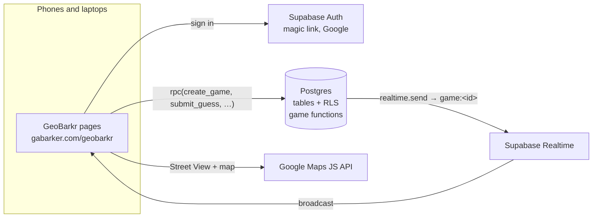
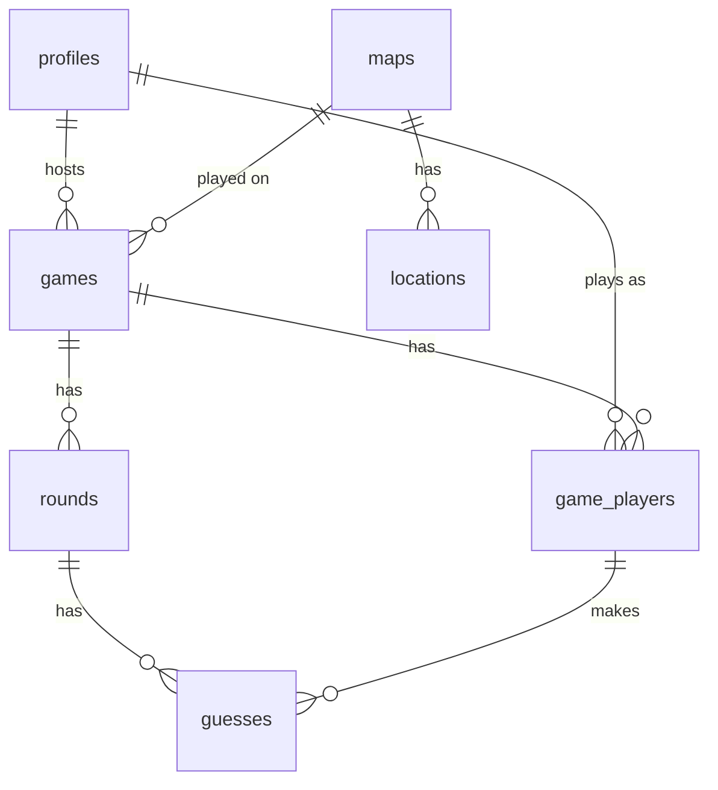

# GeoBarkr web app: architecture (Phase 2 proposal)

This is the plan for rebuilding the ServiceNow game at **gabarker.com/geobarkr**.
It covers the backend choice, the data model (the SQL is already written and
tested, see below), the file layout, how it stays separate from TapMap and
Bearings, and the setup steps you'll do. Nothing is live until you approve
this and merge the Phase 3 PR.

## 1. Summary

| Piece | Choice |
|---|---|
| Hosting | GitHub Pages, as now. Plain HTML, CSS and JavaScript modules: **no build step, no GitHub Actions needed**. Merge the PR and Pages publishes it |
| Backend | **Supabase, a new free project just for GeoBarkr** (not TapMap's) |
| Sign-in | Supabase Auth: **email magic link** and **Google**. Required for every page |
| Data | Supabase Postgres with **row-level security** on every table |
| Game logic | Postgres functions (the port of `GeoBarkrUtils` + the scoring business rule). The browser never decides a score |
| Live updates | Supabase **Realtime broadcast**: one private channel per game, sent by the database |
| Maps | Google Maps JavaScript API + Street View, with a new key locked to gabarker.com |
| QR codes | Drawn in the browser (`qrcode-generator` from cdnjs); no third-party QR service |

## 2. Why Supabase (and not something else)

Supabase fits every requirement on the free plan and you already use it for
TapMap, so the dashboard and the way setup works will be familiar.

- **Firebase** (Auth + Firestore) also has realtime and Google sign-in, but its
  security rules aren't SQL, the game logic would need paid Cloud Functions
  (Blaze plan) to stop players editing their own scores, and it would be a
  second platform to look after.
- **PartyKit / Cloudflare Durable Objects** are great for realtime rooms but
  need a deploy step and a separate auth and database.
- **Supabase** gives auth, Postgres with RLS, server-side functions and
  realtime in one place, all callable from a static page with only the public
  ("publishable") key.

No alternative is better here, so I recommend sticking with your default.

**Free plan limits to know about:**
- Two active free projects per account. GeoBarkr would be your second (TapMap's
  is the first). If you already have two, one would need pausing or a paid
  plan.
- **A free project pauses after 7 days with no activity.** Restoring it is one
  tap in the dashboard and takes a few minutes. If that's annoying before a
  party, I can add an optional weekly "keep-alive" GitHub Action later. It's
  not in this plan.
- Realtime: 200 concurrent connections and 2 million messages a month, far
  more than a party game needs.

## 3. How it fits together



1. A page loads, checks for a signed-in session, and sends you to the sign-in
   page if there isn't one (then back to where you were going).
2. Every game action is one database function call (RPC) such as
   `create_game`, `join_game`, `start_game`, `submit_guess`, `end_round` or
   `next_round`. The function checks who you are (`auth.uid()`), checks you're
   allowed, makes the change, and broadcasts a small event ("guess",
   "round_results", "next_round", …) on the game's private channel.
3. Each screen subscribed to that channel then re-reads the game with
   `get_game_state`. That one function decides what you may see: for example,
   phones in party mode never get the target location until the round ends.
4. As a safety net (phones sleeping, flaky Wi-Fi) screens also re-read every
   15 seconds and whenever the tab comes back into view.

## 4. Roles

| ServiceNow | GeoBarkr | How it's set |
|---|---|---|
| `x_geobarkr.user` | **player** | Every new account, automatically |
| `admin` | **admin** | You run one SQL line in the dashboard (step 9 of the setup) |

Players can't promote themselves: the database only lets a player change
their own display name.

## 5. Data model

The SQL is in `geobarkr/supabase/`:

| File | What it does |
|---|---|
| `migrations/001_schema.sql` | Types and tables |
| `migrations/002_functions.sql` | Scoring, the game functions, reads for results / My games / leaderboard, and the new-user trigger |
| `migrations/003_security.sql` | Row-level security, table and function privileges, and the Realtime channel policy |
| `seed.sql` | The original "GeoBarkr Demo" map and its 5 locations (ServiceNow sys_ids kept as the IDs) |
| `setup.sql` | All of the above in one file, for pasting into the SQL Editor on your phone. Safe to run again |
| `tests/` | A local test run (on a throwaway Postgres that mimics Supabase) with 53 checks of the game flow and the security rules. All pass |



| Table | Main columns |
|---|---|
| `profiles` | `id` (= auth user), `display_name`, `role` (player / admin) |
| `maps` | `name`, `active` |
| `locations` | `map_id`, `name`, `round_number` (1–5, one per round), `lat`, `lng`, `heading`, `pitch` |
| `games` | `code` (6-character room code), `type` (single_player / multiplayer / local_multiplayer), `status` (lobby / in_play / complete / cancelled), `map_id`, `map_name`, `host_id`, timestamps |
| `game_players` | `game_id`, `user_id`, `total_score`, `total_distance_km` |
| `rounds` | `game_id`, `round_number`, a copy of the location (so later edits don't change old games), `status` (ready / in_progress / results / complete), `started_at`, `ended_at` |
| `guesses` | `round_id`, `player_id`, `lat`, `lng`, `distance_km`, `score`, `time_ms` |

### Game functions (what the pages call)

| Function | Who | Does |
|---|---|---|
| `create_game(type, map)` | any player | New game + rounds. Single player starts round 1; online adds you as a player and opens a lobby; in person you're the host screen |
| `join_game(code)` | any player | Joins a lobby by room code (typed or from the QR). Lobby only |
| `start_game(game)` | host | Lobby → playing, round 1 starts. Needs 2+ players |
| `submit_guess(game, lat, lng)` | player in the game | Server works out distance, score and time; adds to totals; moves the round to Results when everyone has guessed |
| `end_round(game)` | host (multiplayer) | Ends the round now; anyone who hasn't guessed scores 0 |
| `next_round(game)` | host (or the solo player) | Next round, or completes the game after the last |
| `get_game_state(game)` | host / players / admin | Everything a game screen needs, with hidden things left out |
| `get_results(game)` | host / players / admin | Scorecards, sorted by total score |
| `my_games()` | signed in | Games you played or hosted, with your score and position |
| `leaderboard(sort)` | signed in | All-time, completed games only: total points, best game, games played, average |

## 6. Security (row-level security)

| | Signed out | Player | Admin |
|---|---|---|---|
| Any table or function | ✗ | | |
| Own profile | | read, rename | read all |
| Maps | | read active | create / edit / delete |
| Locations (the answers) | | ✗ | create / edit / delete |
| Games, players | | only games they're in | read all |
| Rounds (hold targets) | | ✗ (via `get_game_state`) | read all |
| Guesses | | own only (others via `get_game_state`, after Results) | read all |
| Write games / rounds / guesses directly | | ✗ (functions only) | ✗ (functions only) |
| Listen to a game's Realtime channel | | only games they're in | all |

The tests check each line above, including that a player can't make
themselves admin, can't read locations or other players' guesses, can't edit
anyone else's profile, can't join a started game, and can't listen to
another game's channel.

**Keys:** the only key in the repo is the Supabase **publishable** key, which
is designed to be public (RLS does the protecting). The Google Maps key is
public by nature, so it's protected by restrictions in Google Cloud (HTTP
referrer `https://gabarker.com/geobarkr/*`, Maps JavaScript API only, daily
caps). No secret keys go in the repo, and no repo secrets are needed.

## 7. Mobile-first

- Layouts are designed at phone width first, in portrait. Desktop gets the
  side-by-side ServiceNow layout (big Street View, map on the side).
- Phone play: Street View fills the screen; the guess map is a sheet that
  slides up from the bottom and can be expanded. Pinch, drag and tap work
  natively in both. The desktop "map grows on hover" becomes an expand button.
- Buttons are at least 44px tall, nothing relies on hover, and the Guess button
  stays disabled until you've placed a pin.
- Party mode: the host page is designed for a laptop or TV (big Street View,
  live "Guesses this round" list, the room code and QR in the lobby). The
  phone page is just the map, the round number and the Guess button, as in
  ServiceNow.
- `prefers-reduced-motion` and light/dark follow the system, with the
  ServiceNow red (`#cc0000`) as the accent.

## 8. File layout

Everything lives under `geobarkr/`. Each page is a real folder, so URLs are
`gabarker.com/geobarkr/<page>/` and the site's shared `404.html` (used by
TapMap) doesn't change.

```
geobarkr/
  index.html            Start Game: type, map, "How to play"; join with a code
  signin/index.html     Magic link + Google
  play/index.html       Single player and online multiplayer (Street View + map)
  lobby/index.html      Lobby: players, owner badge, info, room code + QR, Start
  host/index.html       In person, host screen: Street View + live guesses + round results
  join/index.html       In person, phone: enter code / arrive from QR, "You're in!" + how to play
  party/index.html      In person, phone: map, Guess, status cards
  results/index.html    Scorecard (single) or results table (multiplayer)
  games/index.html      My games (history) + change display name
  leaderboard/index.html  All-time leaderboard
  admin/index.html      Maps and locations (with Street View preview), games list
  css/geobarkr.css
  js/
    config.js           Supabase URL + publishable key, Google Maps key
    supabase.js         Client, session check, sign-in redirect
    api.js              One function per RPC
    live.js             Realtime channel + 15 s refresh fallback
    maps.js             Google Maps loader, guess map, results map, Street View
    geo.js              Distance/score/time formatting shared with tests
    qr.js, ui.js        QR code, header, cards, toasts
    pages/*.js          One small module per page
  assets/               logo.png, icon.png, minikit.mp3 (from ServiceNow)
  supabase/             SQL (above)
  tests/                Node tests (run by the repo's existing `npm test`)
  docs/                 FEATURE_PARITY.md, ARCHITECTURE.md
  README.md             Overview + setup checklist (Phase 3)
```

**Libraries** (loaded from CDNs with fixed versions, no npm install):
`@supabase/supabase-js@2.117.1` (the same version TapMap uses),
`qrcode-generator@1.4.4`, and the Google Maps JS API.

**Outside `geobarkr/`, the only change is the homepage:** a second project
card in `index.html` matching the TapMap one (number 02, red pin artwork,
"Play at gabarker.com/geobarkr →") and the project count changing from 01 to
02. No change to `styles.css`, `site.js`, `404.html`, `tapmap/`,
`bearingssummary/` or `supabase/`.

## 9. Keeping it separate from TapMap / Bearings

- **Separate Supabase project.** GeoBarkr's tables, users, auth settings and
  redirect URLs live in their own project. Nothing is run against TapMap's
  project (`qmgwlvjvwwrlcuupsttb`), and TapMap's `supabase/` folder isn't
  touched.
- **Separate config.** `geobarkr/js/config.js` holds GeoBarkr's own URL and
  key. TapMap's `tapmap/config.js` is unchanged.
- **Separate sessions.** Both sites are on gabarker.com, but Supabase stores
  each project's sign-in under its own browser key (`sb-<project-id>-auth-token`),
  so signing in or out of one doesn't affect the other.
- **Separate Google sign-in client.** A new OAuth client for GeoBarkr, so
  TapMap's Google sign-in settings stay as they are.
- **Accounts are separate.** A TapMap account isn't a GeoBarkr account (you
  sign in once to each). Sharing accounts would mean putting GeoBarkr into
  TapMap's project, which is what you asked to avoid.

## 10. Setup walkthrough (all doable on your phone)

You'll do these once, in this order. Phase 3's README will repeat them as a
checklist with the exact values filled in.

**Supabase**
1. **Create the project.** supabase.com → your organisation → **New project** →
   name `geobarkr`, a strong database password (save it in your password
   manager; GeoBarkr never needs it), the region nearest you (e.g. London) →
   **Create**. This is a new project; TapMap's project is untouched.
2. **Create the tables.** In the new project: **SQL Editor → New query** → paste the
   whole of `geobarkr/supabase/setup.sql` → **Run**. Check that you're in the
   `geobarkr` project before running.
3. **URLs.** **Authentication → URL Configuration**: Site URL
   `https://gabarker.com/geobarkr/`; Redirect URLs add
   `https://gabarker.com/geobarkr/**`.
4. **Email magic link.** **Authentication → Sign In / Providers → Email**: enabled,
   "Confirm email" on. Supabase's built-in email only sends to members of your
   Supabase team, and only a few emails an hour, so other players need a
   proper sender (decision D1 below):
   - Create a free [Resend](https://resend.com) account → **Domains → Add**
     `gabarker.com` → add the DNS records it shows at your domain registrar →
     **API Keys → Create**.
   - Supabase **Authentication → Emails → SMTP Settings**: enable custom SMTP,
     host `smtp.resend.com`, port `465`, user `resend`, password = the Resend
     API key, sender `geobarkr@gabarker.com`, name `GeoBarkr`. (This secret
     lives in Supabase, never in the repo.)
5. **Google sign-in.** [Google Cloud Console](https://console.cloud.google.com/)
   → create project `GeoBarkr` → **APIs & Services → OAuth consent screen**
   (External; app name GeoBarkr, your email) → **Credentials → Create
   credentials → OAuth client ID → Web application**: Authorized JavaScript
   origin `https://gabarker.com`; Authorized redirect URI
   `https://<your-new-project-id>.supabase.co/auth/v1/callback`. Then in
   Supabase **Authentication → Sign In / Providers → Google**: enable, paste
   the client ID and secret, **Save**.
6. **Copy the public key.** Supabase **Project Settings → API Keys**: copy the
   project URL and the **publishable** key (never the secret / service_role
   key) and send them to me, or paste them into `geobarkr/js/config.js`.

**Google Maps**
7. **New Maps key.** In the same Google Cloud project: **APIs & Services → Library
   → Maps JavaScript API → Enable** (billing must be on; there's a free
   monthly allowance). **Credentials → Create credentials → API key**, then
   edit it:
   - Application restrictions: **Websites** →
     `https://gabarker.com/geobarkr/*`
   - API restrictions: **Restrict key → Maps JavaScript API** only
   - **Save**, and send me the key (it's public by design once restricted).
8. **Cost guard.** **APIs & Services → Maps JavaScript API → Quotas**: set a
   daily cap (I suggest 500 map loads and 500 Street View loads a day), and
   **Billing → Budgets & alerts**: a £5 budget with email alerts. Also restrict
   or delete the old key that's in the ServiceNow repo.

**After the PR is merged**
9. **Make yourself admin.** Sign in to gabarker.com/geobarkr once, then in
   Supabase **SQL Editor** run:
   ```sql
   update public.profiles set role = 'admin'
   where id = (select id from auth.users where email = 'you@example.com');
   ```

No GitHub repo secrets are needed, and there's no build to run.

## 11. Decisions for you

- **D1. Email sign-in sender.** Magic links to anyone other than you need a
  custom SMTP sender. My recommendation is Resend (free: 3,000 emails/month,
  100/day), which needs DNS records adding for gabarker.com. Or launch with
  **Google only** and add magic links later. Which?
- **D2. Leaderboard.** As proposed: all-time, completed games only (all modes),
  with tabs for **Total points** and **Best game** (also showing games played
  and average). OK?
- **D3. Display names.** Taken from Google or the email address on first
  sign-in, editable on the My games page (these names show on leaderboards and
  in lobbies). OK?
- **D4. PR target.** The PR will go into the default branch
  (`claude/placeholder-website-264jmx`), which is what Pages serves. `main` is
  left alone.
